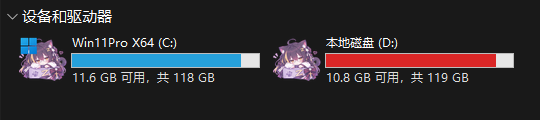
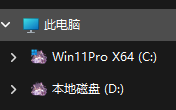

# Drive Icon Customizer · 盘符图标设置工具

> **Set any image as a drive's icon in File Explorer.**
> System drives keep their Windows badge in the top-left corner — and that badge isn't a bundled image, it's extracted from your own machine's original icon at runtime.


[中文](README.md) · **English**

---

## Preview

This is what it looks like once applied:



Both C: (the system drive) and D: have custom icons. The Windows badge in the top-left corner of C: was extracted live from the local original icon by the script.



It takes effect in the left navigation pane as well.

---

## What problem does this solve

Changing a drive icon on Windows usually means installing a bloated utility, or hunting for an `.ico`, editing the registry, clearing the icon cache, and then discovering that the Windows badge on your system drive is gone.

This tool's approach: **pick a drive → pick an image → done.**

- 🖼️ **Accepts anything**: `.ico` / `.png` / `.jpg` / `.bmp` / `.webp` / `.tif` / `.gif`
- 🪟 **System badge preserved automatically**: extracted live from the local original icon and composited on top — no hardcoded image
- 🔄 **Fully reversible**: delete one registry key and you are back to the default. No system files touched
- 🎛️ **Multi-size output**: 10 sizes written in one pass, sharp at any view setting
- 💻 **Scriptable**: an interactive menu for casual use, plus direct arguments and `--dry-run` for previews

---

## Quick start

### Requirements

| Item | Requirement |
|---|---|
| OS | Windows 10 / 11 |
| Python | 3.8 or newer |
| Dependency | Pillow (the only third-party package) |
| Permission | **Administrator** is required to change drive icons (the script raises the UAC prompt itself) |

### Install dependencies

```bat
pip install -r requirements.txt
```

Or simply:

```bat
pip install pillow
```

### Run

```bat
python 设置盘符图标.py
```

With no arguments it opens the interactive menu:

```
            盘符图标设置工具
  1) 设置盘符图标
  2) 还原为系统默认图标
  3) 重启资源管理器（图标没刷新时用）
  0) 退出
```

Pick `1`, follow the prompts to choose a drive and an image, approve the UAC prompt, and the new icon shows up in File Explorer.

> ⚠️ **The menu, the prompts, `--help`, and all error messages are in Chinese only.**
> The script has no English localization. If you don't read Chinese, use the command-line arguments below —
> they don't require you to understand any of the interactive prompts. The table in the next section
> translates every menu item and the messages you're most likely to hit.

> If double-clicking the `.py` file flashes a window and closes, Python isn't associated or Pillow isn't installed.
> Open a CMD prompt in this folder and run `python 设置盘符图标.py` so you can see the error.

### Menu and message reference (for non-Chinese readers)

The interactive menu, in order:

| Option | Chinese | Meaning |
|---|---|---|
| `1` | 设置盘符图标 | Set a drive icon |
| `2` | 还原为系统默认图标 | Restore the system default icon |
| `3` | 重启资源管理器（图标没刷新时用） | Restart Explorer (use when the icon doesn't refresh) |
| `0` | 退出 | Quit |

Prompts and messages you're likely to encounter:

| Chinese | Meaning |
|---|---|
| 请输入要设置图标的磁盘编号（直接回车取消） | Enter the number of the drive to change (or press Enter to cancel) |
| 即将打开文件选择框，请挑一张图 | A file picker will open — choose an image |
| 按回车打开… | Press Enter to open it |
| 已取消。也可以直接把图片路径粘贴到这里（回车跳过） | Cancelled. You can paste the image path here instead (Enter to skip) |
| 这是系统盘，要在左上角叠加 Windows 徽标吗？ | This is the system drive — overlay the Windows badge in the top-left corner? |
| 写入注册表需要管理员权限，正在请求提权… | Writing to the registry requires Administrator; requesting elevation… |
| 已在新的管理员窗口中继续执行，请到那个窗口查看结果。 | Continuing in a new elevated window — check the result there. |
| 授权被取消，未做任何修改。 | Elevation was cancelled; nothing was changed. |
| [错误] 当前不是管理员，无法写入注册表。 | [Error] Not running as Administrator; cannot write to the registry. |
| [错误] 盘符不合法，应为 A~Z 中的一个字母。 | [Error] Invalid drive letter; expected a single letter A–Z. |
| 没有找到可用磁盘。 | No usable drives found. |
| 正在刷新图标缓存… | Refreshing the icon cache… |
| ✔ 已还原为系统默认图标。 | ✔ Restored to the system default icon. |
| ✔ 已重启。 | ✔ Restarted. |
| [提示] 请手动重启或注销后重试。 | [Note] Please restart manually or sign out and retry. |
| [提示] 没能从系统盘当前图标里识别出 Windows 徽标。 | [Note] Could not detect a Windows badge in the current system-drive icon. |
| → 本次不加徽标，直接使用原图。 | → Skipping the badge this time; using the original image. |
| 这张图整体是全透明的（或没有任何可见内容），转成图标会看不见，请换一张。 | This image is fully transparent (or has no visible content); the icon would be invisible. Please choose another. |
| 缺少 Pillow，请先执行：… | Pillow is missing. Please run: … |
| 按回车退出… | Press Enter to exit… |

---

## Command line

```bat
:: Set drive C directly
python 设置盘符图标.py -d C -i image.png

:: System drive, but skip the Windows badge
python 设置盘符图标.py -d C -i image.png --no-logo

:: Restore drive C to the system default icon
python 设置盘符图标.py -d C --restore

:: Generate a preview only, without writing to the registry
python 设置盘符图标.py -d C -i image.png --dry-run

:: Skip auto-elevation (debugging; fails immediately without admin)
python 设置盘符图标.py -d C -i image.png --no-admin
```

| Argument | Description |
|---|---|
| `-d`, `--drive` | Drive letter, e.g. `C` (case-insensitive) |
| `-i`, `--image` | Path to the source image |
| `--restore` | Restore the system default icon |
| `--no-logo` | Do not composite the Windows badge on the system drive |
| `--dry-run` | Generate the icon and preview only; do not touch the registry |
| `--no-admin` | Skip auto-elevation, for debugging |

> `--dry-run` writes its preview to the system temp directory and **never touches the icon currently in use**, so it is safe to try anytime.

---

## How the Windows badge is obtained

This is the interesting part: **the badge is not a bundled image — it is extracted from your own machine at runtime.**

The process:

1. Grab the system drive's current real icon as a 256×256 bitmap through the Windows Shell API
2. Locate the badge in the top-left corner — it differs from the grey drive body by having very high saturation (badge ≈0.9, drive body ≈0.03), so a soft split on the blue channel separates them
3. The extracted badge keeps the original image's alpha channel, so its antialiasing and gradients are genuine, not redrawn
4. Composite it onto your new icon at the measured position and scale ratio

Because both the position and size are measured on the spot, **it stays correct across Windows versions and icon sets** — there isn't a single hardcoded coordinate in the script.

The extracted badge is cached in `badge_cache.png`, so it is reused instead of re-extracted.

---

## Where files are stored

Everything generated lives under:

```
%ProgramData%\DriveIconCustomizer\
├── icons\drive_C.ico      Generated icon (the registry points here)
├── badge_cache.png        System badge cache
└── backup.json            Original registry values, recorded before changes
```

The path is not hardcoded: it tries `ProgramData → LOCALAPPDATA → user profile → temp` in order and uses the first writable location.

Only one registry location is modified:

```
HKEY_LOCAL_MACHINE\SOFTWARE\Microsoft\Windows\CurrentVersion\Explorer\DriveIcons\<drive>\DefaultIcon
```

**No system files are changed.** Deleting this key is equivalent to restoring the default.

---

## About the original character artwork

The files `Zeray哥特萝莉服_透明底.png` and the `.ico` files under `ico/`
feature my original character **Zeray哥特萝莉服**, included here for demonstration.

> **You may use it, but not commercially.**
> Reposting, derivative works, or using it as your own drive icon is fine — enjoy.
> For commercial use, please contact me first.

The program does not depend on these images in any way; they are just samples. Your own artwork works identically.

---

## FAQ

**The icon didn't change.**
Use menu option `3` to restart Explorer first. If it still doesn't update, sign out and back in — Explorer's icon cache can be stubborn.

**Setting drive C had no effect.**
A small number of Windows builds protect `DriveIcons` for the system drive. Try drive D first to confirm the script works, then come back to C.

**It says "no Windows badge found".**
The system drive's icon has already been replaced by something else, so the badge is merged with your artwork and can no longer be separated.
Run **Restore** on the system drive to get the original icon back, then set it again. Once the badge has been extracted once, it is cached and later changes won't need re-extraction.

**The badge position looks odd after changing the image.**
The position is computed from the source image's proportions. If the new image isn't square, the script centers and squares it before compositing, so nothing gets distorted. If you still dislike it, add `--no-logo`.

**Does it work on another machine?**
Yes. There is no hardcoded drive letter, username, or install path — the drive list, the system-drive detection, and the data directory are all derived at runtime. The only requirements are Python 3.8+ and Pillow.

**Antivirus flags it.**
It is a plain Python script, not a packaged exe. It does write to `HKLM` — that is the only reliable way to change a drive icon — but the code touches only the `DriveIcons` key.

---

## Project layout

```
设置盘符\
├── 设置盘符图标.py                 Main program — the only file you need to run
├── 说明.md                         Detailed Chinese manual (internals, cleanup, design notes)
├── README.md                       Chinese README
├── README.en.md                    This file
├── requirements.txt                Python dependencies
├── Zeray哥特萝莉服_透明底.png        Original character artwork (sample image)
├── 截图\
│   ├── 效果_设备和驱动器.png        Result: Devices and drives view
│   └── 效果_导航栏盘符.png          Result: navigation pane
└── ico\
    ├── Zeray哥特萝莉服.ico          Ready-made icon (transparent background)
    └── Zeray哥特萝莉服_满版.ico      Ready-made icon (full bleed)
```

---

## Complete cleanup

1. Run **Restore** for every drive you changed (menu option `2`)
2. Delete the whole `%ProgramData%\DriveIconCustomizer\` folder
3. Delete this folder

---

## License

The program code is released under the [MIT License](LICENSE).
The **Zeray哥特萝莉服** character artwork remains the property of its creator: free to use, not for commercial use — see above.

For deeper details (registry specifics, the badge-extraction algorithm, cleanup steps), see [说明.md](说明.md) (Chinese).
